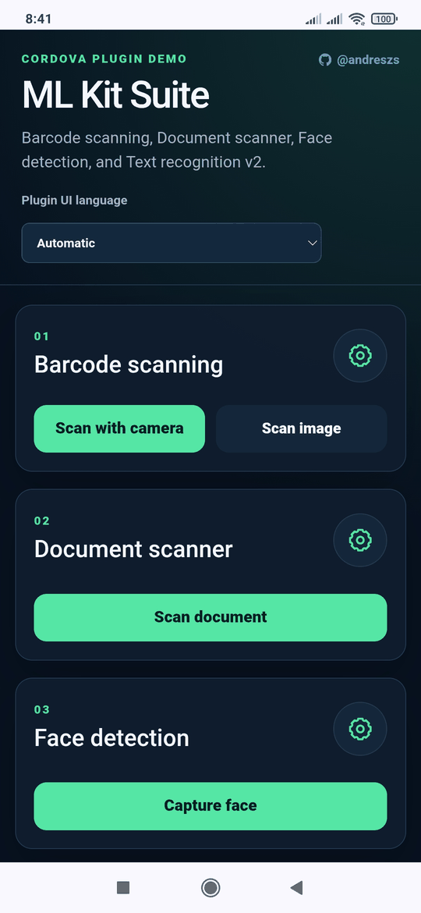
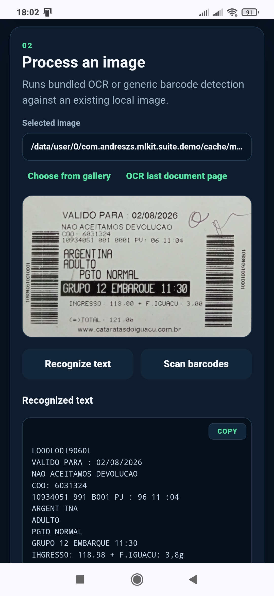
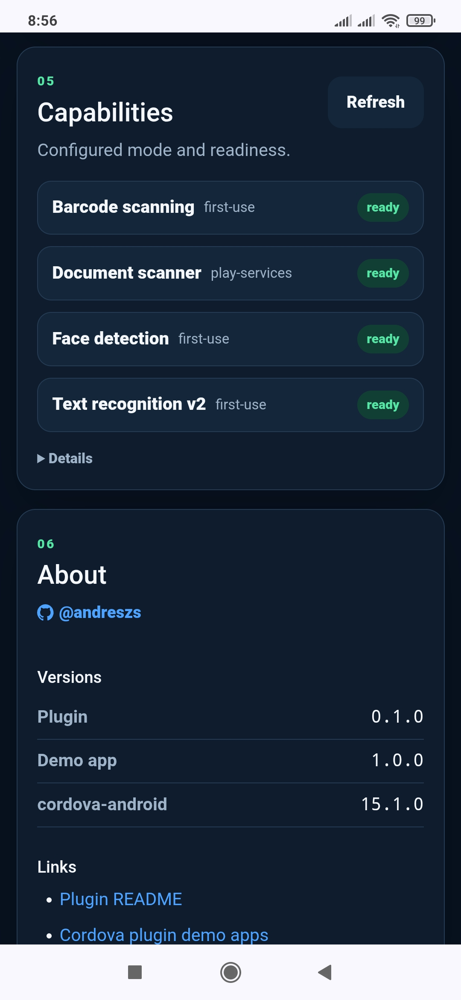
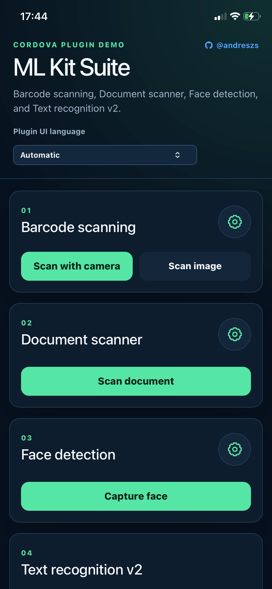
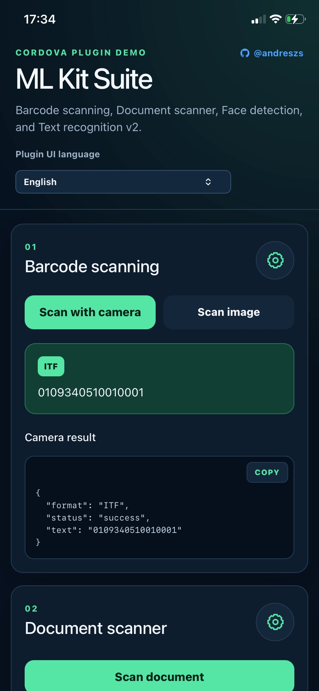

   [](https://github.com/andreszs/cordova-plugin-demos/tree/main/com.andreszs.mlkit.suite.demo)  


# cordova-plugin-mlkit-suite

Extensible [Google ML Kit](https://developers.google.com/ml-kit) integration for Cordova on Android and iOS. Version `0.1.0` includes guided face capture, camera and still-image barcode scanning, Latin text recognition, and the native Android document scanner.

> [!WARNING]
> This plugin is in active development. Its API, defaults, quality thresholds, and native behavior may change before a stable release. Validate every required workflow on representative physical devices before using it in production.

## Table of contents

- [Features](#features)
- [Screenshots](#screenshots)
- [Compatibility](#compatibility)
- [Installation](#installation)
  - [iOS setup](#ios-setup)
- [Android model delivery](#android-model-delivery)
  - [Bundled vs unbundled](#bundled-vs-unbundled)
- [Localization](#localization)
- [API overview](#api-overview)
- [Capabilities](#capabilities)
- [Document scanning](#document-scanning)
  - [Document options](#document-options)
  - [Document result](#document-result)
- [Text recognition](#text-recognition)
- [Barcode detection in an image](#barcode-detection-in-an-image)
- [Camera barcode scanning](#camera-barcode-scanning)
  - [Barcode formats](#barcode-formats)
  - [Camera barcode options](#camera-barcode-options)
- [Face capture](#face-capture)
  - [Face options](#face-options)
  - [Optional face checks](#optional-face-checks)
  - [Face result](#face-result)
- [Cancellation and errors](#cancellation-and-errors)
- [Dependencies and licenses](#dependencies-and-licenses)
- [Privacy](#privacy)
- [Known limitations](#known-limitations)
- [Tests](#tests)

## Features

- **Guided face capture** on Android and iOS, with a front-camera overlay, configurable quality checks, automatic capture, and a local JPEG result.
- **Barcode scanning** from the live camera or an existing image on Android and iOS, supporting all available barcode formats, configurable format filters, scan-region enforcement, and consecutive-frame confirmation.
- **Text recognition v2** for extracting Latin-script text from local images on Android and iOS.
- **Document scanning** on Android, with page limits, scanner modes, gallery import, JPEG pages, and optional PDF output.
- **Per-module Android delivery**, allowing Face Detection, Barcode Scanning, and Text Recognition to use `bundled`, `install-time`, or `first-use` independently.
- **Localized native UI and capability reporting**, with automatic, English, and Spanish UI selection, customizable loading messages, and readiness checks that do not trigger a download.

## Screenshots

<table>
  <tr>
    <th>Demo tour</th>
    <th>Face capture</th>
    <th>Barcode scanning</th>
  </tr>
  <tr>
    <td></td>
    <td></td>
    <td></td>
  </tr>
  <tr>
    <th>Document scanning</th>
    <th>Text recognition</th>
    <th>Capabilities</th>
  </tr>
  <tr>
    <td></td>
    <td></td>
    <td></td>
  </tr>
  <tr>
    <th>iOS demo</th>
    <th>iOS barcode result</th>
    <th>iOS text recognition</th>
  </tr>
  <tr>
    <td></td>
    <td></td>
    <td></td>
  </tr>
</table>

## Compatibility

The plugin requires Cordova 11 or newer. The Android implementation supports `cordova-android` 12 through 15 and therefore requires Android 7.0 / API 24 or newer. It selects a tested CameraX version from the installed `cordova-android` major version.

| cordova-android | CameraX | Bundled Face | Bundled Barcode | Bundled OCR | Document Scanner | Reference toolchain |
| --- | --- | --- | --- | --- | --- | --- |
| 12.x | 1.2.3 | 16.1.7 | 17.2.0 | 16.0.1 | 16.0.0 | compileSdk 33 / AGP 7.4.2 / JDK 11 |
| 13.x | 1.4.2 | 16.1.7 | 17.2.0 | 16.0.1 | 16.0.0 | compileSdk 34 / AGP 8.3.0 / JDK 17 |
| 14.x | 1.5.2 | 16.1.7 | 17.2.0 | 16.0.1 | 16.0.0 | compileSdk 35 / AGP 8.7.3 / JDK 17 |
| 15.x | 1.6.0 | 16.1.7 | 17.2.0 | 16.0.1 | 16.0.0 | compileSdk 36 / AGP 8.10.1 / JDK 17 |

All Android delivery modes share the API 24 floor. Face, Barcode, and OCR can select their delivery modes independently; all default to `install-time`. The Android document-scanner UI and model are always delivered dynamically by Google Play services, require at least 1.7 GB of total RAM, and can require a first-use download. On an unsupported device, `MlKit.scanDocument()` rejects with `UNSUPPORTED_DEVICE`; the other modules remain available. See [Android model delivery](#android-model-delivery) for the delivery strategies. Unknown Cordova Android toolchains fail at build time instead of silently selecting untested versions.

The current Android Google Play services clients are Face Detection `17.1.0`, Barcode Scanning `18.3.1`, and Text Recognition `19.0.1`. The iOS implementation supports `cordova-ios` 8.x and requires iOS 15.5 or newer. Face capture, live and still-image barcode detection, and Latin text recognition use Google ML Kit CocoaPods `8.0.0`. Google does not provide the ML Kit Document Scanner API for iOS; document-scanner methods reject with `UNSUPPORTED_PLATFORM` there.

## Installation

> [!IMPORTANT]
> Choose the Android modes in the install command. By default all three modules use the smaller Google Play services `install-time` mode. No plugin, Gradle, XML, manifest, or generated Android file needs to be edited.

Run the selected command from the Cordova application root. Cordova resolves `cordova-plugin-mlkit-suite` from the public npm registry.

Default — all modules use `install-time`:

```bash
cordova plugin add cordova-plugin-mlkit-suite
```

Apply one mode to Face, Barcode, and OCR with `ANDROID_MLKIT_MODEL_DELIVERY`:

```bash
# Package every model in the application.
cordova plugin add cordova-plugin-mlkit-suite \
  --variable ANDROID_MLKIT_MODEL_DELIVERY=bundled

# Let each model download when its API is first used.
cordova plugin add cordova-plugin-mlkit-suite \
  --variable ANDROID_MLKIT_MODEL_DELIVERY=first-use
```

Override individual modules when a mixed configuration is preferable. A module-specific value has priority over the global value; `inherit` or an omitted module variable uses the global value:

```bash
cordova plugin add cordova-plugin-mlkit-suite \
  --variable ANDROID_MLKIT_MODEL_DELIVERY=install-time \
  --variable ANDROID_MLKIT_FACE_MODE=bundled \
  --variable ANDROID_MLKIT_BARCODE_MODE=first-use
```

The accepted mode values are `bundled`, `install-time`, and `first-use`. The legacy value `play-services` is also accepted as an alias for `install-time`. Available variables are:

| Variable | Default | Scope |
| --- | --- | --- |
| `ANDROID_MLKIT_MODEL_DELIVERY` | `install-time` | Global fallback for all three modules |
| `ANDROID_MLKIT_FACE_MODE` | `inherit` | Face Detection override |
| `ANDROID_MLKIT_BARCODE_MODE` | `inherit` | Barcode Scanning override |
| `ANDROID_MLKIT_OCR_MODE` | `inherit` | Latin Text Recognition override |

For a local checkout, replace the package name with `/absolute/path/to/cordova-plugin-mlkit-suite`. Cordova persists these variables under `cordova.plugins["cordova-plugin-mlkit-suite"].variables` in the **host application's** `package.json`; the plugin reads them while Gradle configures the Android build. Do not manually edit plugin source, `plugins/`, `platforms/android/`, or the generated manifest.

Delivery modes are build-time settings. To change them, remove and re-add this plugin with the new variables, then rebuild; editing `package.json` alone does not update an installed native platform.

### iOS setup

On iOS, configure the deployment target and a camera-purpose string in the host application's `config.xml`:

```xml
<platform name="ios">
    <preference name="deployment-target" value="15.5" />
    <edit-config file="*-Info.plist" mode="merge" target="NSCameraUsageDescription">
        <string>Use the camera to capture a photo.</string>
    </edit-config>
</platform>
```

The plugin requests camera access. Generated images and PDFs are written to the application's private cache, so no storage or Photo Library permission is required.

## Android model delivery

Face Detection, Barcode Scanning, and Latin Text Recognition independently support the two official [ML Kit model installation paths](https://developers.google.com/ml-kit/tips/installation-paths): bundled in the application or unbundled through Google Play services. The plugin exposes `install-time` and `first-use` as two download timings for the same unbundled implementation.

### Bundled vs unbundled

| Feature | Unbundled — Google Play services | Bundled — application package |
| --- | --- | --- |
| Plugin values | `install-time` or `first-use` | `bundled` |
| Implementation | The model is downloaded and managed by Google Play services. | The model is statically linked into the app at build time. |
| App download | Smaller APK/AAB; only the thin client is packaged. | Larger APK/AAB because the model is packaged with the app. |
| First availability | The module must finish downloading before inference can run. | Available immediately after installation. |
| Offline first use | Not guaranteed. | Yes. |
| Model updates | Managed independently by Google Play services. | Require updating and rebuilding the app. |

Google's current size guidance for the exact Android dependency families used by this plugin is:

| Module | Unbundled app-size increase | Bundled app-size increase | Official guide |
| --- | ---: | ---: | --- |
| Face Detection | about 0.8 MB | about 6.9 MB | [Face Detection for Android](https://developers.google.com/ml-kit/vision/face-detection/android) |
| Barcode Scanning | about 0.2 MB | about 2.4 MB | [Barcode Scanning for Android](https://developers.google.com/ml-kit/vision/barcode-scanning/android) |
| Latin Text Recognition | about 0.26 MB per architecture | about 4 MB per script and architecture | [Text Recognition for Android](https://developers.google.com/ml-kit/vision/text-recognition/v2/android) |
| Document Scanner | about 0.3 MB; always delivered through Play services | not available | [Document Scanner for Android](https://developers.google.com/ml-kit/vision/doc-scanner/android) |

These are Google's incremental estimates, not final APK sizes. Build type, compression, transitive libraries, and included CPU architectures affect the result. An AAB lets Google Play deliver only the device's required architecture, but it does not change a bundled module into an unbundled one.

The plugin modes choose when each implementation becomes available:

| Mode | Implementation | Download timing | Best fit |
| --- | --- | --- | --- |
| `install-time` (**default**) | Unbundled | Requested after installation from Google Play; completion is best effort. | Small app with proactive delivery for normal Play Store installs. |
| `first-use` | Unbundled | Downloaded when the app first calls that module, unless prepared earlier. | Small app where unused modules should never download. |
| `bundled` | Bundled | Included in the APK/AAB; no model download. | Immediate offline availability is more important than package size. |

For `install-time`, the plugin adds the selected modules to the generated Android manifest so Google Play can request them after installation. This is best effort and may still be incomplete at first use, especially for a sideloaded APK. `first-use` skips that request and downloads a module when its API is first called. Google Play services can update managed models independently, but not the Java client libraries selected at build time.

When an unbundled module is missing, the plugin shows a native spinner, waits for the download, and then continues the requested operation. Its default text follows the resolved plugin locale; set `moduleLoadingMessage` to custom text, or to an empty string for a spinner without a label:

```javascript
await MlKit.recognizeText(imagePath, {
    moduleLoadingMessage: "Descargando reconocimiento de texto…"
});
```

Use `MlKit.prepareModels()` to download all unbundled modules proactively, or pass selected module names:

```javascript
await MlKit.prepareModels(["barcode", "ocr"], {
    moduleLoadingMessage: "Preparando funciones de cámara…"
});
```

`prepareModels()` and `prepareDocumentScanner()` resolve with the same result shape:

```json
{ "status": "ready", "alreadyAvailable": true }
```

`alreadyAvailable` is `true` when no download was needed and `false` when the call completed a download.

`MlKit.getCapabilities()` reports each module's configured mode and readiness without starting a download. Document Scanner is separate: it is always delivered through Google Play services and can be prepared with `MlKit.prepareDocumentScanner()`.

## Localization

Plugin-owned camera instructions, accessibility labels, loading text, and user-facing native errors are available in English and Spanish. Every options object accepts an optional `locale`:

```javascript
await MlKit.face.capture({ locale: "es-AR" });
await MlKit.barcode.scan({ locale: "auto" });
```

`auto` is the default and uses the application/device language resolved natively at runtime. `en`, `es`, and BCP-47 tags such as `en-US` or `es-AR` are accepted; unsupported languages safely fall back to English. Explicit `instructionText` and `moduleLoadingMessage` values always take precedence, including an empty string.

Android translations live in `src/android/res/values*/mlkit_suite_strings.xml`; iOS translations live in `src/ios/MlKitSuiteResources.bundle/*.lproj/Localizable.strings`. Add the same keys in a new platform locale directory to extend the plugin. Stable result values and error codes are never translated.

The Google Document Scanner UI is owned by Google Play services and follows the locale selected by that component. Its public API has no locale override, so `locale` controls the plugin's loading and error messages around the flow but cannot force the language of Google's scanner screens.

## API overview

| Method | Android | iOS | Purpose |
| --- | --- | --- | --- |
| `MlKit.getCapabilities()` | yes | yes | Describes modules available on the current platform and device. |
| `MlKit.prepareModels(modules?, options?)` | yes | yes | Ensures all or selected Face, Barcode, and Latin OCR modules are ready; bundled modules resolve immediately. |
| `MlKit.prepareDocumentScanner(options?)` | Android 7+ and 1.7 GB RAM | no | Checks and installs the on-demand Google Play services scanner component. |
| `MlKit.scanDocument(options?)` | Android 7+ and 1.7 GB RAM | no | Opens Google's native document capture, crop, filter, and cleanup UI. |
| `MlKit.recognizeText(imagePath, options?)` | yes | yes | Returns plain Latin-script text from a local image. |
| `MlKit.scanBarcodes(imagePath, options?)` | yes | yes | Returns every matching barcode detected in a local image. |
| `MlKit.barcode.scan(options?)` | yes | yes | Opens a high-resolution rear-camera barcode scanner. |
| `MlKit.face.capture(options?)` | yes | yes | Opens guided front-camera face capture with automatic capture. |

All methods return Promises. The plugin processes content locally and does not interpret, validate, upload, or transform decoded payloads for a particular country or document type.

## Capabilities

Use `getCapabilities()` to discover platform and device support:

```javascript
const capabilities = await MlKit.getCapabilities();

if (capabilities.document.scan && capabilities.document.deviceSupported) {
    // The native document flow can be requested on this device.
}
```

The exact shape on a supported Android device using the default `install-time` mode is:

```json
{
  "platform": "android",
  "offline": false,
  "modelDelivery": "play-services",
  "modelDownloadStrategy": "install-time",
  "localization": {
    "default": "auto",
    "supportedLocales": ["en", "es"],
    "deviceLocale": "es-AR",
    "resolvedLocale": "es"
  },
  "face": {
    "capture": true, "frontCamera": true, "autoCapture": true,
    "mode": "install-time", "bundled": false,
    "ready": true, "modelStatus": "downloaded"
  },
  "barcode": {
    "scan": true, "scanImage": true,
    "mode": "install-time", "bundled": false,
    "ready": true, "modelStatus": "downloaded",
    "resolution": "1920x1080", "confirmationFrames": 2,
    "formats": ["AZTEC", "CODABAR", "CODE_39", "CODE_93", "CODE_128", "DATA_MATRIX", "EAN_8", "EAN_13", "ITF", "PDF_417", "QR_CODE", "UPC_A", "UPC_E"]
  },
  "document": {
    "scan": true, "prepare": true, "deviceSupported": true,
    "minimumAndroidApi": 24, "dynamicallyDelivered": true,
    "mode": "play-services", "minimumTotalRamMb": 1700,
    "resultFormats": ["JPEG", "PDF"],
    "ready": true, "modelStatus": "downloaded"
  },
  "text": {
    "recognize": true, "mode": "install-time", "bundled": false,
    "ready": true, "modelStatus": "downloaded", "scripts": ["LATIN"]
  }
}
```

Locale and readiness values vary at runtime. A read-only Google Play services check supplies `ready` (`true`, `false`, or `null`) and `modelStatus` (`bundled`, `downloaded`, `not-ready`, `unsupported`, or `unknown`) without starting a download. Root delivery fields report `mixed` when module modes differ. Android reports `offline: false` because Document Scanner is dynamically delivered. iOS reports bundled Face, Barcode, and Text modules with `offline: true`; its `document` object reports `scan: false`, `prepare: false`, `mode: "unsupported"`, `ready: false`, and `modelStatus: "unsupported"`.

## Document scanning

`MlKit.scanDocument(options?)` opens the [Google ML Kit Document Scanner](https://developers.google.com/ml-kit/vision/doc-scanner) on Android. The native flow handles capture, automatic edge detection, crop adjustment, rotation, cleanup, filters, and optional gallery import.

The scanner UI, logic, and models are an on-demand Google Play services component. `scanDocument()` now prepares that component automatically and shows the native loading indicator only when a download is required. Call `prepareDocumentScanner()` earlier only when proactive preparation better suits the application flow:

```javascript
await MlKit.prepareDocumentScanner({
    moduleLoadingMessage: "Preparando el escáner…"
});
```

```javascript
const result = await MlKit.scanDocument({
    pageLimit: 4,
    galleryImportAllowed: true,
    resultFormats: ["JPEG", "PDF"],
    scannerMode: "FULL",
    moduleLoadingMessage: "Preparando el escáner…"
});

if (result.status === "success") {
    document.querySelector("img").src = result.pages[0].imageUri;
    console.log(result.pdf && result.pdf.path);
}
```

The method performs device checks before requesting the Google scanner. Android versions below API 24 and devices with less than 1.7 GB of total RAM reject with `UNSUPPORTED_DEVICE` instead of opening native scanner code.

### Document options

| Option | Type | Default | Description |
| --- | --- | --- | --- |
| `pageLimit` | integer `1–100` | `1` | Maximum number of pages in one scan. |
| `galleryImportAllowed` | `boolean` | `true` | Allows importing document images from the gallery. |
| `resultFormats` | `string[] \| string \| null` | `["JPEG", "PDF"]` | Requests JPEG pages, a PDF, or both. A comma-separated string is accepted. `null` uses the default; `JPG` aliases `JPEG`. |
| `scannerMode` | `"BASE" \| "BASE_WITH_FILTER" \| "FULL" \| null` | `"FULL"` | Selects the native editing feature set. `null` uses the default. `BASE` still includes crop, rotation, page removal, and page reordering. |
| `moduleLoadingMessage` | `string \| null` | localized | Android text shown only while downloading the scanner component. Empty string shows only the spinner. |
| `locale` | `string` | `"auto"` | Plugin loading/error locale. Google's scanner UI resolves its own locale. |

Unknown options, invalid types, empty result formats, and out-of-range values reject with `INVALID_ARGUMENT`.

### Document result

```json
{
  "status": "success",
  "pages": [
    {
      "imagePath": "/data/user/0/<app-id>/cache/mlkit-suite/document-...-page-1.jpg",
      "imageUri": "https://localhost/_mlkit_suite_image_/document-...-page-1.jpg",
      "mimeType": "image/jpeg",
      "bytes": 182734,
      "width": 1440,
      "height": 1920
    }
  ],
  "pdf": {
    "path": "/data/user/0/<app-id>/cache/mlkit-suite/document-....pdf",
    "uri": "https://localhost/_mlkit_suite_document_/document-....pdf",
    "mimeType": "application/pdf",
    "bytes": 251809,
    "pageCount": 1
  }
}
```

`pages` is empty when JPEG was not requested. `pdf` is `null` when PDF was not requested. Use `imageUri` for an `` inside the Cordova WebView; its scheme and hostname follow the host application's Cordova configuration. Native paths are intended for APIs such as `recognizeText()` and `scanBarcodes()`.

## Text recognition

`MlKit.recognizeText(imagePath, options?)` runs [ML Kit Text Recognition v2](https://developers.google.com/ml-kit/vision/text-recognition/v2) for the Latin script against a local image and resolves to one plain string. Android uses the selected delivery mode; iOS always bundles the recognizer. An image containing no recognized text resolves to `""`.

```javascript
const text = await MlKit.recognizeText(result.pages[0].imagePath, {
    moduleLoadingMessage: "Cargando reconocimiento de texto…"
});
console.log(text);
```

`imagePath` can be an absolute native file path, a `file:` URI, an Android `content:` URI, or an `imageUri` previously returned by this plugin. Remote HTTP images are not fetched.

## Barcode detection in an image

`MlKit.scanBarcodes(imagePath, options?)` uses [ML Kit Barcode Scanning](https://developers.google.com/ml-kit/vision/barcode-scanning) to analyze one existing local image and resolves to an array. It does not require the camera UI or two-frame confirmation.

```javascript
const barcodes = await MlKit.scanBarcodes(imagePath, {
    formats: ["PDF_417", "QR_CODE"],
    moduleLoadingMessage: "Cargando detector de códigos…"
});

for (const barcode of barcodes) {
    console.log(barcode.text, barcode.format);
}
```

Omit `formats` to enable every supported format. `moduleLoadingMessage` follows the common native-indicator rules above. Each detected value includes `text`, `format`, numeric `valueType`, `boundingBox`, and `cornerPoints`. An image containing no matching barcode resolves to `[]`.

```json
[
  {
    "text": "https://example.com",
    "format": "QR_CODE",
    "valueType": 8,
    "boundingBox": { "x": 120, "y": 84, "width": 420, "height": 418 },
    "cornerPoints": [
      { "x": 120, "y": 84 },
      { "x": 540, "y": 84 },
      { "x": 540, "y": 502 },
      { "x": 120, "y": 502 }
    ]
  }
]
```

`boundingBox` can be `null`; `cornerPoints` can be empty. Coordinates use the source image's pixel coordinate system. `valueType` is the platform ML Kit enum value, and `format` is one of the names below or `UNKNOWN` if the native SDK reports an unrecognized value.

## Camera barcode scanning

`MlKit.barcode.scan(options?)` combines [ML Kit Barcode Scanning](https://developers.google.com/ml-kit/vision/barcode-scanning) with the plugin's own full-screen rear-camera UI on Android and iOS:

```javascript
const result = await MlKit.barcode.scan({
    formats: ["PDF_417", "QR_CODE"],
    showCloseButton: true,
    showTorchButton: true,
    instructionText: "Place a barcode inside the frame",
    guideColor: null,
    moduleLoadingMessage: "Cargando detector de códigos…",
    timeoutMs: 45000
});

if (result.status === "success") {
    console.log(result.text, result.format);
}
```

```json
{ "status": "success", "text": "https://example.com", "format": "QR_CODE" }
```

Android requests `1920×1080` analysis frames from CameraX; iOS requests the equivalent AVFoundation `hd1920x1080` preset. Each platform falls back to the closest suitable high-resolution stream supported by the camera. The four-color corner guide is the active scan region: codes outside it or crossing its edges are ignored. A result is returned only after two consecutive analyzed frames contain exactly the same non-empty text and format while fully inside the guide. A missing, outside, or different value resets confirmation.

### Barcode formats

Both barcode methods support all 13 formats exposed by ML Kit Barcode Scanning:

- `AZTEC`
- `CODABAR`
- `CODE_39`
- `CODE_93`
- `CODE_128`
- `DATA_MATRIX`
- `EAN_8`
- `EAN_13`
- `ITF`
- `PDF_417`
- `QR_CODE`
- `UPC_A`
- `UPC_E`

`PDF417` is accepted as an alias of `PDF_417`. A comma-separated string is accepted in addition to an array.

### Camera barcode options

| Option | Type | Default | Description |
| --- | --- | --- | --- |
| `formats` | `string[] \| string \| null` | all formats | Formats to detect. Restricting formats generally improves speed. |
| `showCloseButton` | `boolean` | `true` | Shows the native close button. Android Back still cancels when hidden. |
| `showTorchButton` | `boolean` | `true` | Shows a torch toggle when the rear camera has flash hardware. |
| `instructionText` | `string \| null` | `"Place a barcode inside the frame"` | Text shown above the guide. An empty string hides it. |
| `guideColor` | `string \| null` | `null` | Optional `#RRGGBB` color for all four guide corners. When omitted, the default blue, yellow, green, and red corners are used. A detected in-guide barcode always changes them to green. |
| `moduleLoadingMessage` | `string \| null` | localized | Android text shown only while downloading Barcode Scanning. Empty string shows only the spinner. |
| `locale` | `string` | `"auto"` | Plugin UI/error locale (`en`, `es`, or BCP-47). |
| `timeoutMs` | integer `0–600000` | `0` | Session timeout in milliseconds. `0` disables it. |

## Face capture

`MlKit.face.capture(options?)` combines [ML Kit Face Detection](https://developers.google.com/ml-kit/vision/face-detection) with a full-screen native front-camera guide and resolves after a valid JPEG is captured:

```javascript
const result = await MlKit.face.capture({
    outputWidth: 600,
    outputHeight: 720,
    jpegQuality: 95,
    showCloseButton: true,
    debugMode: false,
    instructionText: "Place your face inside the oval",
    moduleLoadingMessage: "Cargando detector facial…",
    checks: {
        singleFace: true,
        faceSize: true,
        centering: true,
        pose: true,
        eyesOpen: true,
        neutralExpression: true,
        stability: true,
        sharpness: true,
        brightness: true
    },
    timeoutMs: 45000
});
```

Capture starts automatically only after all enabled checks remain acceptable for a short stability window.

### Face options

| Option | Type | Default | Description |
| --- | --- | --- | --- |
| `outputWidth` | integer `320–2048` | `600` | Exact JPEG width in pixels. |
| `outputHeight` | integer `320–2048` | `720` | Exact JPEG height in pixels and crop aspect ratio. |
| `jpegQuality` | integer `50–100` | `95` | JPEG encoding quality. |
| `showCloseButton` | `boolean` | `true` | Shows the native close button. |
| `debugMode` | `boolean` | `false` | Shows face bounds and live quality values without weakening validation. |
| `instructionText` | `string \| null` | `"Place your face inside the oval"` | Text shown above the guide. An empty string hides it. |
| `moduleLoadingMessage` | `string \| null` | localized | Android text shown only while downloading Face Detection. Empty string shows only the spinner. |
| `locale` | `string` | `"auto"` | Plugin UI/error locale (`en`, `es`, or BCP-47). |
| `checks` | `object \| null` | all enabled | Enables or disables individual capture gates. |
| `timeoutMs` | integer `0–600000` | `0` | Session timeout in milliseconds. `0` disables it. |

### Optional face checks

| Check | Default | Purpose |
| --- | --- | --- |
| `singleFace` | `true` | Requires exactly one detected face. |
| `faceSize` | `true` | Rejects faces that are too small or too close. |
| `centering` | `true` | Requires the face near the guide center. |
| `pose` | `true` | Limits head yaw, pitch, and roll. |
| `eyesOpen` | `true` | Requires both eye-open probabilities to pass the internal threshold. |
| `neutralExpression` | `true` | Rejects a high smiling probability. |
| `stability` | `true` | Requires a stable face position before capture. |
| `sharpness` | `true` | Rejects low-detail frames and final images. |
| `brightness` | `true` | Rejects images that are too dark or too bright. |

### Face result

```json
{
  "status": "success",
  "imageUri": "<cordova-scheme>://<hostname>/_mlkit_suite_image_/face-...jpg",
  "imagePath": "<app-cache>/mlkit-suite/face-...jpg",
  "width": 600,
  "height": 720,
  "mimeType": "image/jpeg",
  "bytes": 78421,
  "capturedAt": "2026-10-15T12:34:56.789Z",
  "quality": { "brightness": 0.57, "sharpness": 0.41 },
  "face": {
    "yaw": 1.2,
    "pitch": -0.8,
    "roll": 0.5,
    "leftEyeOpenProbability": 0.98,
    "rightEyeOpenProbability": 0.97,
    "smilingProbability": 0.04
  },
  "appliedChecks": {
    "singleFace": true,
    "faceSize": true,
    "centering": true,
    "pose": true,
    "eyesOpen": true,
    "neutralExpression": true,
    "stability": true,
    "sharpness": true,
    "brightness": true
  }
}
```

`imageUri` uses the host application's configured Cordova scheme and hostname. Cache files are temporary and may be removed by the operating system.

Eye-open and smiling probabilities can be `null` when ML Kit does not provide them for the captured face.

## Cancellation and errors

User cancellation of an interactive native UI resolves rather than rejects:

```javascript
{ "status": "cancelled", "reason": "user" }
```

Other failures reject with a stable shape:

```json
{
  "code": "UNSUPPORTED_DEVICE",
  "message": "ML Kit Document Scanner requires Android 7.0 or newer and at least 1.7 GB of total RAM.",
  "recoverable": false
}
```

| Code | Meaning |
| --- | --- |
| `INVALID_ARGUMENT` | An argument, option, or check is invalid. |
| `INVALID_IMAGE` | The supplied local image cannot be opened or decoded. |
| `BUSY` | Another interactive native session is active. |
| `CAMERA_PERMISSION_DENIED` | Camera permission is unavailable. |
| `CAMERA_UNAVAILABLE` | The requested camera or pipeline could not be opened. |
| `CAPTURE_FAILED` | No acceptable final face photo was obtained. |
| `PROCESSING_FAILED` | ML Kit or output persistence could not complete. |
| `SCANNER_UNAVAILABLE` | The document scanner could not be downloaded, initialized, or opened. |
| `MODULE_DOWNLOAD_CANCELLED` | Google Play services cancelled a requested model or scanner-component installation. |
| `MODULE_DOWNLOAD_FAILED` | Google Play services could not check or install the requested modules. |
| `UNSUPPORTED_DEVICE` | The current Android version, memory, or Google implementation does not support the document scanner. |
| `UNSUPPORTED_PLATFORM` | The requested module is not implemented on the current platform. |
| `TIMEOUT` | The configured interactive-session timeout elapsed. |
| `UNKNOWN` | The JavaScript bridge received an unstructured or otherwise unknown native error. |

## Dependencies and licenses

The plugin uses Google ML Kit, [AndroidX CameraX](https://developer.android.com/media/camera/camerax), and Apple system frameworks including AVFoundation. Plugin source is licensed under the MIT License; platform dependencies retain their own licenses and terms.

## Privacy

The plugin requests camera permission and processes camera frames and selected local images. It does not include analytics, advertising, network upload code, face recognition, or persistent biometric storage. The document scanner is provided dynamically through Google Play services. The host application controls returned files and is responsible for privacy disclosures, consent, retention, transport security, and regulatory compliance.

The included Apple privacy manifest declares no tracking, collected data, or required-reason API use by the plugin itself. Host applications and transitive SDKs must provide their own accurate manifests.

## Known limitations

- The document scanner is Android-only, requires API 24 and at least 1.7 GB RAM, depends on Google Play services, and can require a first-use component download.
- The Google Document Scanner always allows basic page editing, including crop and rotation; its native UI cannot be configured as an immutable front/back capture flow.
- Text recognition currently includes only the Latin script recognizer.
- Face detection is not face recognition, identity verification, liveness detection, or presentation-attack detection.
- Static-image APIs accept local resources only and do not download remote URLs.
- Face quality thresholds are heuristics and require calibration across devices, skin tones, lighting, optics, and accessibility needs.
- The face oval is a visual guide; the returned JPEG is rectangular.
- Cache URLs are session-local and are not durable storage.
- A physical device is required to validate camera and document-scanner behavior.
- The iOS implementation must be compiled and device-tested on macOS with a compatible Xcode and CocoaPods toolchain.

## Tests

Run the JavaScript, Java confirmation, iOS source-contract, and localization-resource tests:

```bash
npm test
```

Before release, validate installation and a debug build with each supported Cordova Android major. Build iOS with `cordova-ios` 8.x on macOS, then test the native flows on physical devices.
