   [](https://github.com/andreszs/cordova-plugin-demos/tree/main/com.andreszs.mlkit.suite.demo) 


# cordova-plugin-mlkit-suite

`cordova-plugin-mlkit-suite` is a [Google ML Kit](https://developers.google.com/ml-kit) computer-vision plugin for Apache Cordova on Android and iOS. Its JavaScript API provides guided face capture, live and still-image barcode scanning, OCR with Text Recognition v2, document scanning, image labeling, selfie segmentation, subject segmentation, and background removal through native ML Kit SDKs.

> [!WARNING]
> This plugin is in active development. Its API, defaults, quality thresholds, and native behavior may change before a stable release. Validate every required workflow on representative physical devices before using it in production.

## Table of contents

- [Overview](#overview)
- [Compatibility](#compatibility)
- [Quick start](#quick-start)
- [Android model delivery](#android-model-delivery)
- [Localization](#localization)
- [API](#api)
  - [Barcode scanning](#barcode-scanning)
  - [Document scanning](#document-scanning)
  - [Face capture](#face-capture)
  - [Image labeling](#image-labeling)
  - [Selfie segmentation](#selfie-segmentation)
  - [Subject segmentation](#subject-segmentation)
  - [Text recognition v2](#text-recognition-v2)
- [Cancellation and errors](#cancellation-and-errors)
- [Privacy and limitations](#privacy-and-limitations)
- [Support](#support)
- [Tests](#tests)

## Overview

- **Guided face capture** on Android and iOS, with a front-camera overlay, configurable quality checks, automatic capture, and a local JPEG result.
- **Barcode scanning** from the live camera or an existing image on Android and iOS, supporting all available barcode formats, configurable format filters, scan-region enforcement, consecutive-frame confirmation, animated success feedback, and an optional confirmation beep.
- **Text recognition v2** for extracting Latin-script text from local images on Android and iOS.
- **Document scanning** on Android, with page limits, scanner modes, gallery import, JPEG pages, and optional PDF output.
- **Image labeling** for classifying local images with ML Kit's general-purpose default model on Android and iOS.
- **Selfie segmentation** for separating people from the background and producing a transparent PNG on Android and iOS.
- **Subject segmentation** for separating foreground people, pets, and objects from the background on Android.

| Module | Android | iOS |
| --- | --- | --- |
| [Barcode scanning](#barcode-scanning) | ✅ Live camera and still images | ✅ Live camera and still images |
| [Document scanner](#document-scanning) | ✅ Available | ❌ Not available |
| [Face detection](#face-capture) | ✅ Guided face capture | ✅ Guided face capture |
| [Image labeling](#image-labeling) | ✅ Default model | ✅ Default model |
| [Selfie segmentation](#selfie-segmentation) | ✅ Transparent PNG | ✅ Transparent PNG |
| [Subject segmentation](#subject-segmentation) | ✅ Transparent PNG | ❌ Not available |
| [Text recognition v2](#text-recognition-v2) | ✅ Latin script | ✅ Latin script |

Android model delivery is configurable per module. Native plugin UI and errors support automatic, English, and Spanish localization.

## Compatibility

The plugin requires Cordova 11 or newer.

| Platform | Supported Cordova platform | Minimum OS |
| --- | --- | --- |
| Android | `cordova-android` 12.x–15.x | Android 7.0 / API 24 |
| iOS | `cordova-ios` 8.x | iOS 15.5 |

### Android compatibility notes

Document Scanner on Android additionally requires Google Play services and at least 1.7 GB of total RAM.

The Android implementation selects a tested CameraX version for each supported `cordova-android` major:

| cordova-android | CameraX | Reference toolchain |
| --- | --- | --- |
| 12.x | 1.2.3 | compileSdk 33 / AGP 7.4.2 / JDK 11 |
| 13.x | 1.4.2 | compileSdk 34 / AGP 8.3.0 / JDK 17 |
| 14.x | 1.5.2 | compileSdk 35 / AGP 8.7.3 / JDK 17 |
| 15.x | 1.6.0 | compileSdk 36 / AGP 8.10.1 / JDK 17 |

Unknown `cordova-android` majors fail at build time instead of silently selecting untested dependencies. On an unsupported Android device, `MlKit.scanDocument()` rejects with `UNSUPPORTED_DEVICE` without affecting the other modules.

Model packaging and download behavior are documented separately under [Android model delivery](#android-model-delivery).

## Quick start

Install the plugin from the Cordova application root:

```bash
cordova plugin add cordova-plugin-mlkit-suite
```

All methods return Promises. For example, open the native barcode scanner and inspect the result:

```javascript
const result = await MlKit.barcode.scan({
    formats: ["QR_CODE", "PDF_417"]
});

if (result.status === "success") {
    console.log(result.text, result.format);
}
```

On Android, Face Detection, Barcode Scanning, Image Labeling, OCR, and Subject Segmentation default to the smaller Google Play services `install-time` strategy. Selfie Segmentation is always bundled by ML Kit. See [Android model delivery](#android-model-delivery) to bundle configurable models or defer supported downloads.

### iOS setup

On iOS, configure the deployment target and a camera-purpose string in the host application's `config.xml`:

```xml
<platform name="ios">
    <preference name="deployment-target" value="15.5" />
    <edit-config file="*-Info.plist" mode="merge" target="NSCameraUsageDescription">
        <string>Use the camera to capture a photo.</string>
    </edit-config>
</platform>
```

The plugin requests camera access. Generated images are written to the application's private cache, so no storage or Photo Library permission is required.

## Android model delivery

Face Detection, Barcode Scanning, Image Labeling, and Latin Text Recognition can independently use the official ML Kit [bundled or unbundled installation paths](https://developers.google.com/ml-kit/tips/installation-paths). Subject Segmentation is always unbundled through Google Play services but can use `install-time` or `first-use`. Document Scanner is always delivered dynamically by Google Play services. Selfie Segmentation only supports ML Kit's bundled installation path.

| Mode | Implementation | Download timing | Best fit |
| --- | --- | --- | --- |
| `install-time` (**default**) | Unbundled | Requested after installation from Google Play; completion is best effort. | Small app with proactive delivery for normal Play Store installs. |
| `first-use` | Unbundled | Downloaded when the app first calls that module, unless prepared earlier. | Small app where unused modules should never download. |
| `bundled` | Bundled | Included in the APK/AAB; no model download. | Immediate offline availability is more important than package size. |

Apply one mode as the global fallback during installation:

```bash
cordova plugin add cordova-plugin-mlkit-suite \
  --variable ANDROID_MLKIT_MODEL_DELIVERY=bundled
```

Module-specific variables override the global value; `inherit` uses the global setting:

| Module | Installation variable | Valid values |
| --- | --- | --- |
| Global fallback | `ANDROID_MLKIT_MODEL_DELIVERY` | `bundled`, `install-time`, `first-use`, `play-services` |
| Face Detection | `ANDROID_MLKIT_FACE_MODE` | `inherit`, `bundled`, `install-time`, `first-use`, `play-services` |
| Barcode Scanning | `ANDROID_MLKIT_BARCODE_MODE` | `inherit`, `bundled`, `install-time`, `first-use`, `play-services` |
| Image Labeling | `ANDROID_MLKIT_IMAGE_LABELING_MODE` | `inherit`, `bundled`, `install-time`, `first-use`, `play-services` |
| Latin Text Recognition | `ANDROID_MLKIT_OCR_MODE` | `inherit`, `bundled`, `install-time`, `first-use`, `play-services` |
| Selfie Segmentation | None | `bundled` only |
| Subject Segmentation | `ANDROID_MLKIT_SUBJECT_SEGMENTATION_MODE` | `inherit`, `install-time`, `first-use`, `play-services` |
| Document Scanner | None | Google Play services only |

The global fallback defaults to `install-time`; module variables default to `inherit`. `play-services` aliases `install-time`. Subject Segmentation resolves inherited `bundled` to `install-time`.

These are build-time settings, so remove and re-add the plugin to change them. Do not edit generated Gradle, manifest, `plugins/`, or `platforms/android/` files.

When an unbundled module is missing, the plugin shows a native spinner, waits for the download, and then continues the requested operation. Its default text follows the resolved plugin locale; set `moduleLoadingMessage` to custom text, or to an empty string for a spinner without a label:

```javascript
await MlKit.recognizeText(imagePath, {
    moduleLoadingMessage: "Downloading text recognition…"
});
```

Use `prepareModels()` to download selected modules proactively:

```javascript
await MlKit.prepareModels(["barcode", "image-labeling", "ocr"], {
    moduleLoadingMessage: "Preparing ML Kit models…"
});
```

Preparation resolves with `{ "status": "ready", "alreadyAvailable": true }`; `alreadyAvailable` is `false` when the call completed a download. `getCapabilities()` reports configured modes and readiness without starting one.

## Localization

Plugin-owned camera instructions, accessibility labels, loading text, and user-facing native errors are available in English and Spanish. Every options object accepts an optional `locale`:

```javascript
await MlKit.face.capture({ locale: "es-AR" });
await MlKit.barcode.scan({ locale: "auto" });
```

`auto` is the default and uses the application/device language resolved natively at runtime. `en`, `es`, and BCP-47 tags such as `en-US` or `es-AR` are accepted; unsupported languages safely fall back to English. Explicit barcode `instructionText` and `moduleLoadingMessage` values always take precedence, including an empty string.

Android translations live in `src/android/res/values*/mlkit_suite_strings.xml`; iOS translations live in `src/ios/MlKitSuiteResources.bundle/*.lproj/Localizable.strings`. Add the same keys in a new platform locale directory to extend the plugin. Stable result values and error codes are never translated.

The Google Document Scanner UI is owned by Google Play services and follows the locale selected by that component. Its public API has no locale override, so `locale` controls the plugin's loading and error messages around the flow but cannot force the language of Google's scanner screens.

## API

| Method | Android | iOS | Purpose |
| --- | --- | --- | --- |
| `MlKit.getCapabilities()` | ✅ | ✅ | Describes modules available on the current platform and device. |
| `MlKit.prepareModels(modules?, options?)` | ✅ | ✅ | Ensures all or selected Face, Barcode, Image Labeling, Latin OCR, and Subject Segmentation modules are ready; bundled modules resolve immediately. |
| `MlKit.prepareDocumentScanner(options?)` | ✅ | ❌ | Checks and installs the on-demand Google Play services scanner component. |
| `MlKit.scanDocument(options?)` | ✅ | ❌ | Opens Google's native document capture, crop, filter, and cleanup UI. |
| `MlKit.labelImage(imagePath, options?)` | ✅ | ✅ | Returns labels from ML Kit's default image-labeling model. |
| `MlKit.segmentSelfie(imagePath, options?)` | ✅ | ✅ | Creates a transparent PNG containing the people found in a local image. |
| `MlKit.segmentSubjects(imagePath, options?)` | ✅ | ❌ | Creates a transparent PNG containing foreground subjects from a local image. |
| `MlKit.recognizeText(imagePath, options?)` | ✅ | ✅ | Returns plain Latin-script text from a local image. |
| `MlKit.scanBarcodes(imagePath, options?)` | ✅ | ✅ | Returns every matching barcode detected in a local image. |
| `MlKit.barcode.scan(options?)` | ✅ | ✅ | Opens a high-resolution rear-camera barcode scanner. |
| `MlKit.face.capture(options?)` | ✅ | ✅ | Opens guided front-camera face capture with automatic capture. |

Document Scanner requires at least 1.7 GB of total device RAM.

All methods return Promises. The plugin processes content locally and does not interpret, validate, upload, or transform decoded payloads for a particular country or document type.

### Capabilities

Use `getCapabilities()` to discover platform and device support:

```javascript
const capabilities = await MlKit.getCapabilities();

if (capabilities.document.scan && capabilities.document.deviceSupported) {
    // The native document flow can be requested on this device.
}
```

The result contains `platform`, localization details, and `face`, `barcode`, `document`, `imageLabeling`, `selfieSegmentation`, `subjectSegmentation`, and `text` capability objects. Each module reports its configured `mode`, `ready` state, and `modelStatus` without starting a download. Android can report `mixed` when configurable module modes differ. Selfie Segmentation is bundled on both platforms; Subject Segmentation is an unbundled Android module. On iOS, Subject Segmentation and Document Scanner report `unsupported`.

### Barcode scanning

Both barcode APIs use [ML Kit Barcode Scanning](https://developers.google.com/ml-kit/vision/barcode-scanning). Use still-image detection for existing local files or the native camera flow for interactive scanning.

<table>
  <tr>
    <th>Live scanner</th>
    <th>Settings</th>
  </tr>
  <tr>
    <td>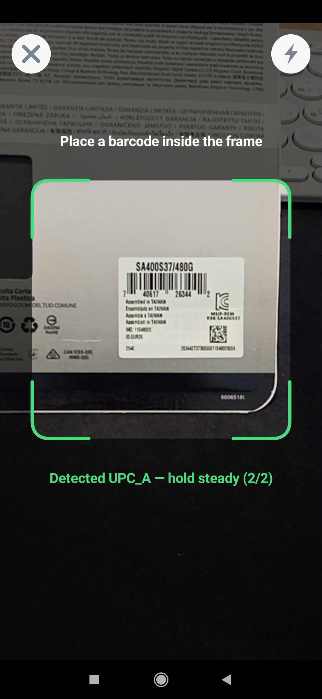</td>
    <td>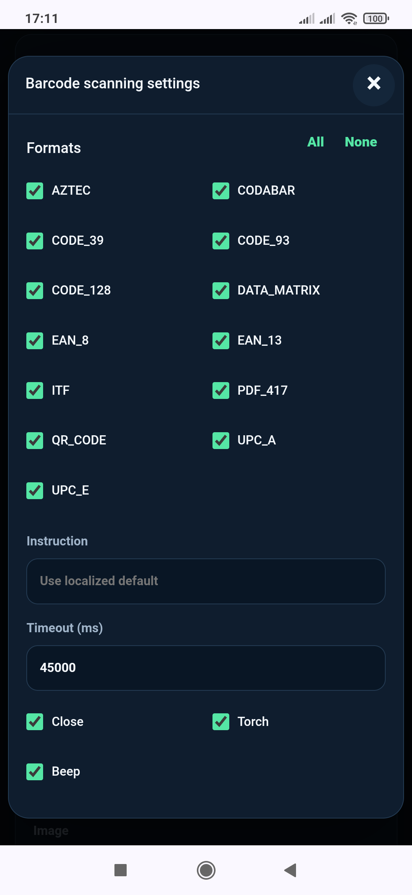</td>
  </tr>
</table>

#### Barcode detection in an image

`MlKit.scanBarcodes(imagePath, options?)` uses [ML Kit Barcode Scanning](https://developers.google.com/ml-kit/vision/barcode-scanning) to analyze one existing local image and resolves to an array. It does not require the camera UI or two-frame confirmation.

```javascript
const barcodes = await MlKit.scanBarcodes(imagePath, {
    formats: ["PDF_417", "QR_CODE"],
    moduleLoadingMessage: "Loading barcode detector…"
});

for (const barcode of barcodes) {
    console.log(barcode.text, barcode.format);
}
```

Omit `formats` to enable every supported format. `moduleLoadingMessage` follows the common native-indicator rules above. Each detected value includes `text`, `format`, numeric `valueType`, `boundingBox`, and `cornerPoints`. An image containing no matching barcode resolves to `[]`.

```json
{ "text": "https://example.com", "format": "QR_CODE", "valueType": 8 }
```

`boundingBox` can be `null`; `cornerPoints` can be empty. Coordinates use the source image's pixel coordinate system. `valueType` is the platform ML Kit enum value, and `format` is one of the names below or `UNKNOWN` if the native SDK reports an unrecognized value.

#### Camera barcode scanning

`MlKit.barcode.scan(options?)` combines [ML Kit Barcode Scanning](https://developers.google.com/ml-kit/vision/barcode-scanning) with the plugin's own full-screen rear-camera UI on Android and iOS:

```javascript
const result = await MlKit.barcode.scan({
    formats: ["PDF_417", "QR_CODE"],
    timeoutMs: 45000
});

if (result.status === "success") {
    console.log(result.text, result.format);
}
```

```json
{ "status": "success", "text": "https://example.com", "format": "QR_CODE" }
```

Android requests `1920×1080` analysis frames from CameraX; iOS requests the equivalent AVFoundation `hd1920x1080` preset. Each platform falls back to the closest suitable high-resolution stream supported by the camera. The four-color corner guide is the active scan region: codes outside it or crossing its edges are ignored. A result is returned only after two consecutive analyzed frames contain exactly the same non-empty text and format while fully inside the guide. A missing, outside, or different value resets confirmation. On success, the scanner freezes the confirmed camera frame and animates the guide onto the detected code before returning the result.

##### Barcode formats

Both barcode methods support `AZTEC`, `CODABAR`, `CODE_39`, `CODE_93`, `CODE_128`, `DATA_MATRIX`, `EAN_8`, `EAN_13`, `ITF`, `PDF_417`, `QR_CODE`, `UPC_A`, and `UPC_E`. `PDF417` aliases `PDF_417`; comma-separated strings are accepted in addition to arrays.

##### Camera barcode options

| Option | Type | Default | Description |
| --- | --- | --- | --- |
| `formats` | `string[] \| string \| null` | all formats | Formats to detect. Restricting formats generally improves speed. |
| `showCloseButton` | `boolean` | `true` | Shows the native close button. Android Back still cancels when hidden. |
| `showTorchButton` | `boolean` | `true` | Shows a torch toggle when the rear camera has flash hardware. |
| `beepEnabled` | `boolean` | `true` | Plays a short synthesized confirmation beep after a successful scan. Device silent mode is respected. |
| `instructionText` | `string \| null` | `"Place a barcode inside the frame"` | Text shown above the guide. An empty string hides it. |
| `guideColor` | `string \| null` | `null` | Optional `#RRGGBB` color for all four guide corners. When omitted, the default blue, yellow, green, and red corners are used. A detected in-guide barcode always changes them to green. |
| `moduleLoadingMessage` | `string \| null` | localized | Android text shown only while downloading Barcode Scanning. Empty string shows only the spinner. |
| `locale` | `string` | `"auto"` | Plugin UI/error locale (`en`, `es`, or BCP-47). |
| `timeoutMs` | integer `0–600000` | `0` | Session timeout in milliseconds. `0` disables it. |

### Document scanning

`MlKit.scanDocument(options?)` opens the [Google ML Kit Document Scanner](https://developers.google.com/ml-kit/vision/doc-scanner) on Android. The native flow handles capture, automatic edge detection, crop adjustment, rotation, cleanup, filters, and optional gallery import.

<table>
  <tr>
    <th>Result</th>
    <th>Settings</th>
  </tr>
  <tr>
    <td>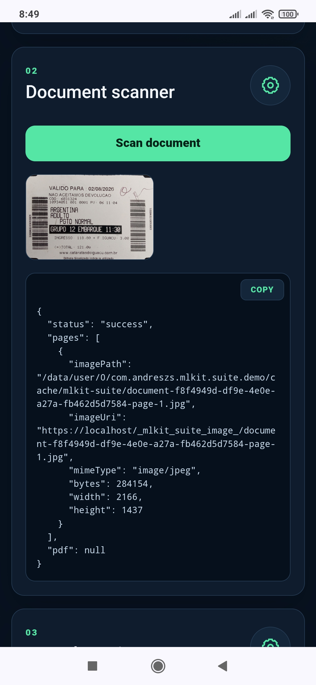</td>
    <td>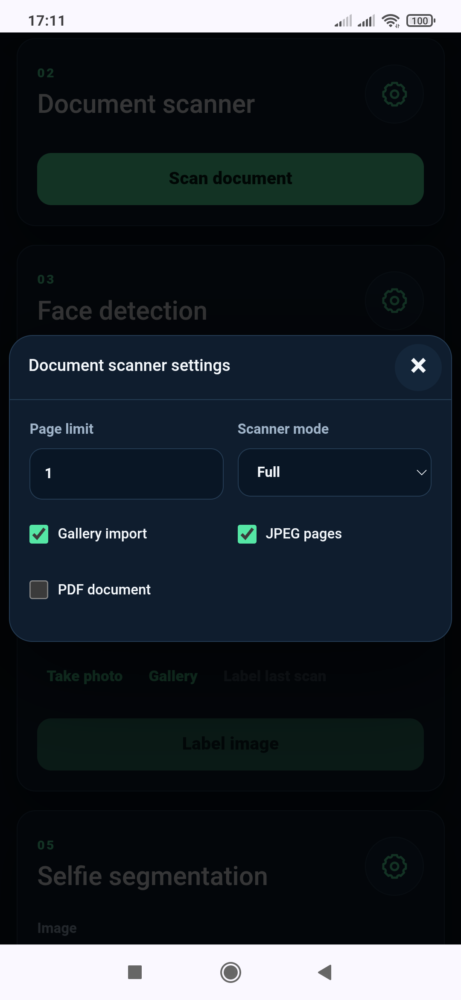</td>
  </tr>
</table>

The scanner UI, logic, and models are an on-demand Google Play services component. `scanDocument()` now prepares that component automatically and shows the native loading indicator only when a download is required. Call `prepareDocumentScanner()` earlier only when proactive preparation better suits the application flow:

```javascript
await MlKit.prepareDocumentScanner({
    moduleLoadingMessage: "Preparing document scanner…"
});
```

```javascript
const result = await MlKit.scanDocument({
    pageLimit: 4,
    galleryImportAllowed: true,
    resultFormats: ["JPEG", "PDF"],
    scannerMode: "FULL",
    moduleLoadingMessage: "Preparing document scanner…"
});

if (result.status === "success") {
    document.querySelector("img").src = result.pages[0].imageUri;
    console.log(result.pdf && result.pdf.path);
}
```

The method performs device checks before requesting the Google scanner. Android versions below API 24 and devices with less than 1.7 GB of total RAM reject with `UNSUPPORTED_DEVICE` instead of opening native scanner code.

#### Document options

| Option | Type | Default | Description |
| --- | --- | --- | --- |
| `pageLimit` | integer `1–100` | `1` | Maximum number of pages in one scan. |
| `galleryImportAllowed` | `boolean` | `true` | Allows importing document images from the gallery. |
| `resultFormats` | `string[] \| string \| null` | `["JPEG", "PDF"]` | Requests JPEG pages, a PDF, or both. A comma-separated string is accepted. `null` uses the default; `JPG` aliases `JPEG`. |
| `scannerMode` | `"BASE" \| "BASE_WITH_FILTER" \| "FULL" \| null` | `"FULL"` | Selects the native editing feature set. `null` uses the default. `BASE` still includes crop, rotation, page removal, and page reordering. |
| `moduleLoadingMessage` | `string \| null` | localized | Android text shown only while downloading the scanner component. Empty string shows only the spinner. |
| `locale` | `string` | `"auto"` | Plugin loading/error locale. Google's scanner UI resolves its own locale. |

Unknown options, invalid types, empty result formats, and out-of-range values reject with `INVALID_ARGUMENT`.

#### Document result

Successful results contain `status`, a `pages` array, and an optional `pdf` object. Each page reports `imagePath`, WebView-safe `imageUri`, MIME type, byte size, width, and height. The PDF reports its native `path`, WebView-safe `uri`, MIME type, byte size, and page count.

`pages` is empty when JPEG was not requested and `pdf` is `null` when PDF was not requested. Use `imageUri` inside the Cordova WebView and native paths with APIs such as `recognizeText()`, `scanBarcodes()`, `labelImage()`, `segmentSelfie()`, and `segmentSubjects()`.

### Face capture

`MlKit.face.capture(options?)` combines [ML Kit Face Detection](https://developers.google.com/ml-kit/vision/face-detection) with a full-screen native front-camera guide and resolves after a valid JPEG is captured.

<table>
  <tr>
    <th>Guided capture</th>
    <th>Settings</th>
  </tr>
  <tr>
    <td>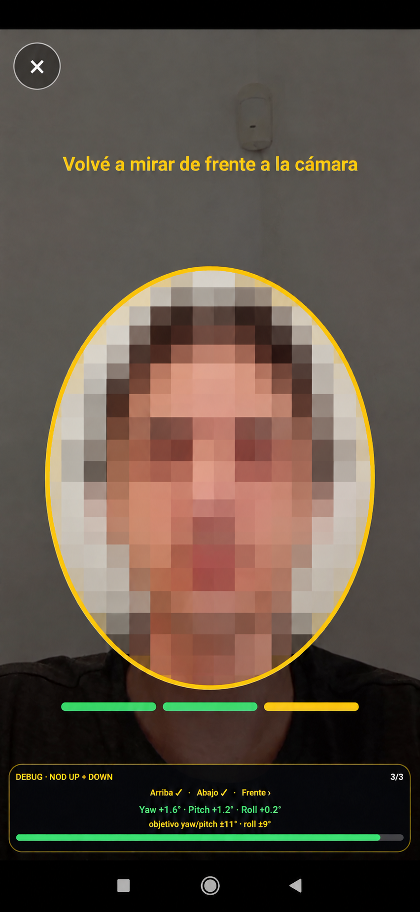</td>
    <td>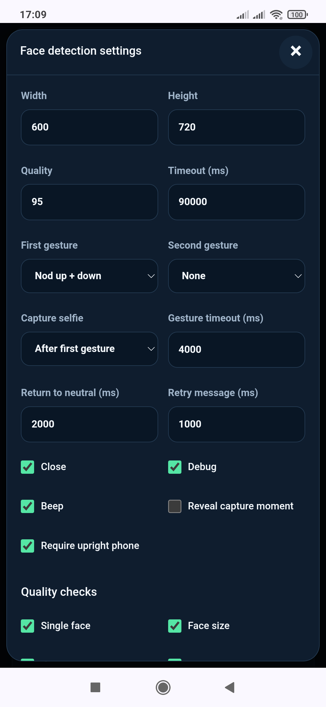</td>
  </tr>
</table>

Example:

```javascript
const result = await MlKit.face.capture({
    outputWidth: 600,
    outputHeight: 720,
    gestures: ["OPEN_MOUTH", "NOD"],
    captureAfterGesture: 1,
    revealCapture: false,
    requireDeviceVertical: true,
    debugMode: false,
    timeoutMs: 90000
});
```

All checks except `eyesOpen` and `neutralExpression` are enabled by default. Capture starts automatically only after the enabled checks remain acceptable for a short stability window.

#### Face options

| Option | Type | Default | Description |
| --- | --- | --- | --- |
| `outputWidth` | integer `320–2048` | `600` | Exact JPEG width in pixels. |
| `outputHeight` | integer `320–2048` | `720` | Exact JPEG height in pixels and crop aspect ratio. |
| `jpegQuality` | integer `50–100` | `95` | JPEG encoding quality. |
| `showCloseButton` | `boolean` | `true` | Shows the native close button. |
| `debugMode` | `boolean` | `false` | Shows only active live requirements. During gestures, a compact responsive panel exposes the tracker phase, current relative movement, exact target, and a visual acceptance meter. Without gestures it keeps the compact active-check view, including device tilt when enabled. Validation is not weakened. |
| `beepEnabled` | `boolean` | `true` | Plays a short synthesized confirmation beep after a successful capture. Device silent mode is respected. |
| `revealCapture` | `boolean` | `true` | Shows the capturing state and message. Set to `false` to take the photo without revealing the exact moment. |
| `requireDeviceVertical` | `boolean` | `true` | Requires the phone to remain within ±10° of vertical for 700 ms before accepting the face or arming a gesture. The overlay asks the user to position it at eye level. Set to `false` to disable this sensor gate. |
| `moduleLoadingMessage` | `string \| null` | localized | Android text shown only while downloading Face Detection. Empty string shows only the spinner. |
| `locale` | `string` | `"auto"` | Plugin UI/error locale (`en`, `es`, or BCP-47). |
| `gestures` | `string[]` | `[]` | Ordered challenge sequence, with at most five gestures. Each gesture is armed only after the face remains frontal and neutral for a stability pause, and then ends in a neutral pose. |
| `captureAfterGesture` | `integer` | gesture count | Captures after this many completed gestures. Use `1` with two gestures to keep the candidate private until the second gesture succeeds. |
| `gestureTimeoutMs` | `integer 1000–15000` | `4000` | Maximum time to complete each armed gesture. |
| `neutralTimeoutMs` | `integer 500–5000` | `2000` | Maximum time to return to neutral after a gesture. |
| `retryMessageMs` | `integer 250–3000` | `1000` | Time the restart message remains visible before the whole sequence resets. |
| `checks` | `object \| null` | see below | Enables or disables individual capture gates. |
| `timeoutMs` | integer `0–600000` | `90000` | Face-capture timeout in milliseconds (90 seconds by default). `0` disables it. |

#### Optional face checks

| Check | Default | Purpose |
| --- | --- | --- |
| `singleFace` | `true` | Requires exactly one detected face. |
| `faceSize` | `true` | Rejects faces that are too small or too close. |
| `centering` | `true` | Projects the detected face into the visible camera preview and requires its center to remain inside the oval's central safe region. The check is suspended while an armed gesture is being performed. |
| `pose` | `true` | Limits head yaw, pitch, and roll. |
| `eyesOpen` | `false` | Requires both eye-open probabilities to pass the internal threshold. Disabled by default because ML Kit may not classify every user's eyes reliably. |
| `neutralExpression` | `false` | Rejects a high smiling probability. Disabled by default because expression classification can vary between users. |
| `stability` | `true` | Requires a stable face position before capture. |
| `sharpness` | `true` | Rejects low-detail frames and final images. |
| `brightness` | `true` | Rejects images that are too dark or too bright. |

#### Face result

Successful results include the JPEG's `imagePath`, WebView-safe `imageUri`, dimensions, MIME type, byte size, and capture time. The `quality` object contains brightness and sharpness; `face` contains yaw, pitch, roll, eye-open probabilities, and smiling probability; `appliedChecks` records the checks used for capture.

Cache files are temporary. Eye-open and smiling probabilities can be `null` when ML Kit does not provide them.

Supported gesture names are `OPEN_MOUTH`, `BLINK`, `SMILE`, `LOOK_UP`, `LOOK_DOWN`, `NOD`,
and `SHAKE`. `NOD` requires looking up and then down before returning
to neutral, and the overlay identifies the current up/down subphase. While any gesture is active,
centering and pose guidance cannot replace the gesture instruction. Both stages of `SHAKE` use the same
15-degree horizontal threshold. `SHAKE` requires right first and then left, with matching subphase guidance. The successful result
includes `completedGestures` in the requested order. These active challenges are capture gates,
not presentation-attack detection by themselves.

After every accepted gesture phase, its instruction remains visible in green for 500 ms. This applies
to both subphases of `NOD` and `SHAKE` and to every single-phase gesture. Gesture evaluation and its
timeout are frozen during the confirmation pause; the oval also turns green and the corresponding
progress segment advances to its next success color. The next instruction appears only after the pause
ends.

The first gesture cannot be satisfied by movement made while the camera is opening. The plugin first
requires a frontal neutral face for 650 ms before arming it. The same pause is required before every
later gesture, so movement from the previous gesture cannot spill into the next one. Gesture angles
are measured relative to that stable neutral pose, avoiding false rejections caused by a small natural
ML Kit pitch or yaw offset. Before arming, pitch outside the frontal range produces a directional
instruction to raise or lower the head instead of the generic look-straight message.

By default, face capture also uses the device gravity sensor as an initial positioning gate. The phone
must remain within ±10° of vertical for 700 ms before face framing, gesture validation, or capture
can proceed. Tilting it beyond the exit tolerance invalidates an active gesture sequence. Devices that
do not expose a usable gravity or motion sensor continue without this gate. This check helps establish
the intended posture but is not, by itself, presentation-attack detection.

The native overlay shows progress as a segmented bar instead of a numeric gesture counter. It contains
one segment for the initial accepted face, one per requested gesture, and one for the photo capture.
Completed segments remain green, the current segment is yellow, and future segments remain gray;
therefore one gesture produces three segments and two gestures produce four. Compound gestures retain
an intermediate yellow-green segment after their first accepted subphase and turn fully green after
their second. Every segment color change uses the same smooth 260 ms transition. Overlay labels wrap
within the safe screen width.
The segmented bar is placed directly below the oval; no secondary instruction label is rendered in
that lower region.
The overlay reserves separate responsive regions for guidance, progress, framing, instructions, and
optional debug metrics. On shorter screens it reduces and lowers the oval before allowing labels to
overlap; debug metrics use a compact secondary layout and consume no space when debug mode is off.
When gestures are active in debug mode, the compact metrics are replaced by a contextual tracker panel.
It shows the neutral and action phases, current relative value, exact threshold, and a visual acceptance
meter. Secondary raw, baseline, remaining-distance, and hold-time lines are omitted to preserve space.
The panel height follows this compact content and ends immediately below the meter.
The final segment, green `Ready` message, confirmation beep, and successful result are emitted only
after the JPEG passes final processing; `Ready` is never shown while that processing is still pending.

When `captureAfterGesture` is before the end of the sequence, the JPEG remains private to the
native plugin. It is returned only after all later gestures pass in the same camera session. A
timeout, prolonged missing/replaced face, invalid final frame, or capture failure deletes the candidate and
restarts the complete sequence.

During an active gesture, a face-tracking interruption of up to 300 ms freezes all gesture and hold
timers without advancing a subphase or permitting capture. Tracking resumes from the same point if the
face returns within that margin; a longer interruption restarts the complete sequence.

### Image labeling

`MlKit.labelImage(imagePath, options?)` uses [ML Kit Image Labeling](https://developers.google.com/ml-kit/vision/image-labeling) to classify one local image with the general-purpose default model. It resolves to an array of labels ordered by the native SDK; an image with no matching labels resolves to `[]`.

<table>
  <tr>
    <th>Demo workflow</th>
    <th>Settings</th>
  </tr>
  <tr>
    <td>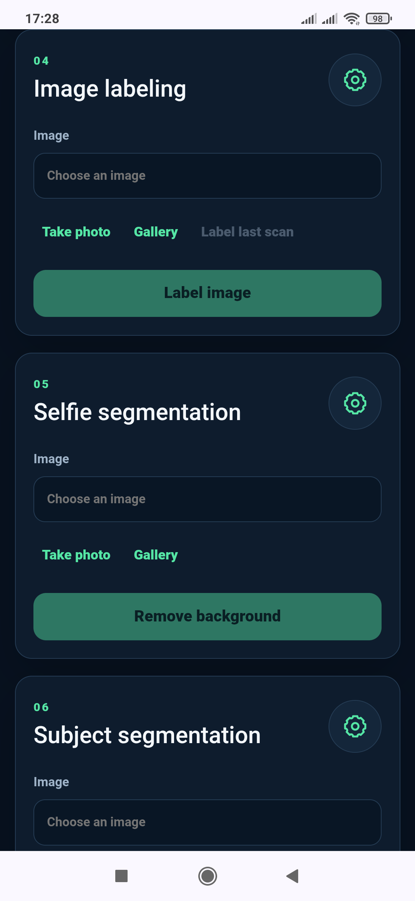</td>
    <td>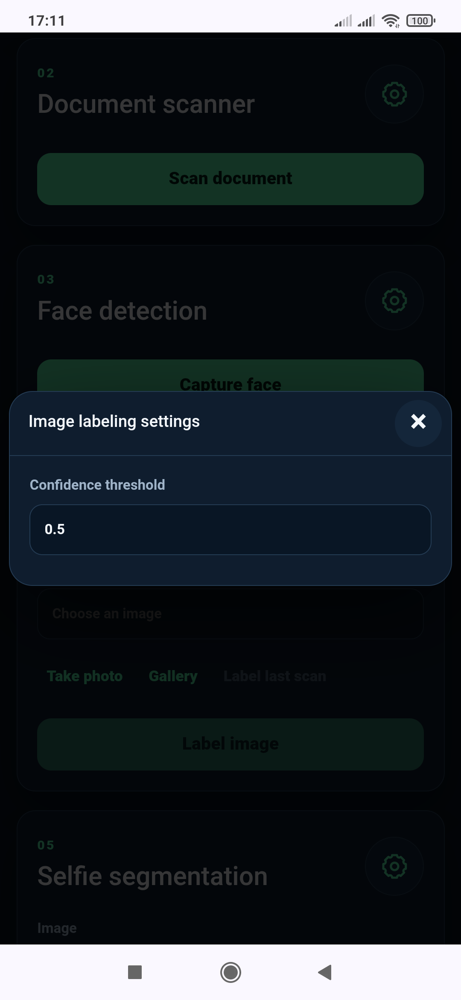</td>
  </tr>
</table>

```javascript
const labels = await MlKit.labelImage(imagePath, {
    confidenceThreshold: 0.6,
    moduleLoadingMessage: "Loading image labeling…"
});

for (const label of labels) {
    console.log(label.text, label.confidence, label.index);
}
```

```json
[
  { "text": "Food", "confidence": 0.93, "index": 12 }
]
```

`confidenceThreshold` is an optional number from `0` to `1`; ML Kit's native default is used when omitted. Each result contains `text`, `confidence`, and the default model's `index`. Android follows the configured delivery mode; iOS bundles the model.

### Selfie segmentation

`MlKit.segmentSelfie(imagePath, options?)` uses [ML Kit Selfie Segmentation](https://developers.google.com/ml-kit/vision/selfie-segmentation) in single-image mode. It separates every person from the background and writes a temporary PNG whose alpha channel contains ML Kit's foreground-confidence mask.

<table>
  <tr>
    <th>Demo workflow</th>
    <th>Settings</th>
  </tr>
  <tr>
    <td>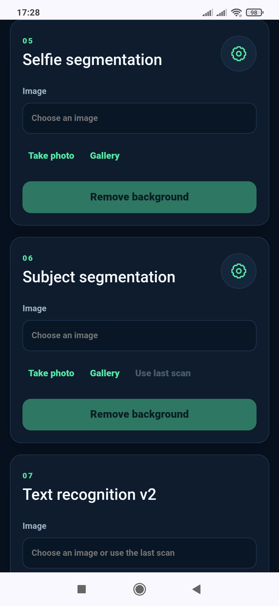</td>
    <td>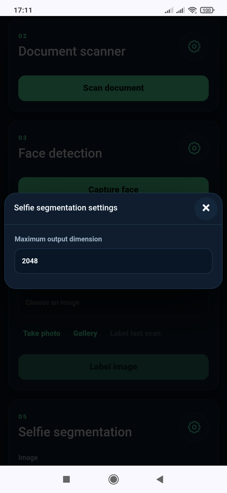</td>
  </tr>
</table>

```javascript
const result = await MlKit.segmentSelfie(imagePath, {
    maxDimension: 2048
});

document.querySelector("img").src = result.imageUri;
console.log(result.imagePath, result.width, result.height, result.bytes);
```

The successful result contains `status`, WebView-safe `imageUri`, native `imagePath`, `width`, `height`, `mimeType: "image/png"`, and `bytes`. `maxDimension` accepts an integer from `256` to `4096` and defaults to `2048`; larger inputs are proportionally reduced before processing. The model is bundled on Android and iOS, so this method never triggers a Play services download.

### Subject segmentation

`MlKit.segmentSubjects(imagePath, options?)` uses [ML Kit Subject Segmentation](https://developers.google.com/ml-kit/vision/subject-segmentation) on Android to isolate the combined foreground from people, animals, or objects and save it as a transparent PNG.

<table>
  <tr>
    <th>Demo workflow</th>
    <th>Settings</th>
  </tr>
  <tr>
    <td>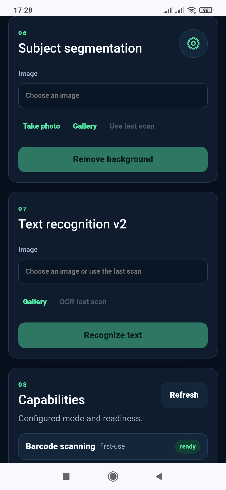</td>
    <td>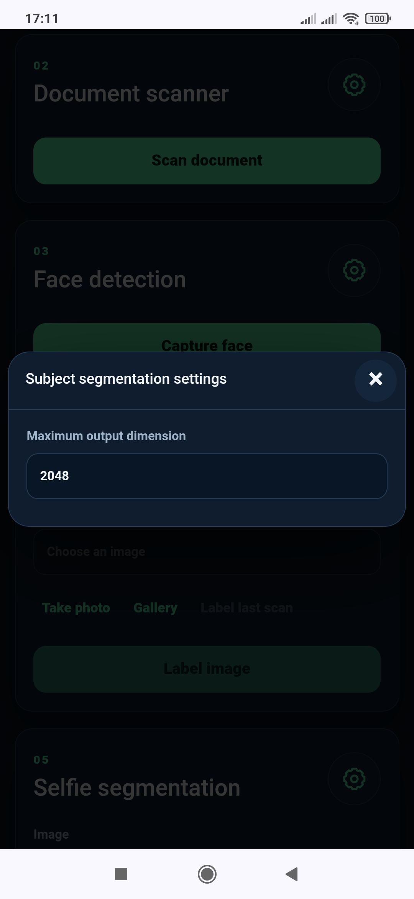</td>
  </tr>
</table>

```javascript
const result = await MlKit.segmentSubjects(imagePath, {
    maxDimension: 2048,
    moduleLoadingMessage: "Loading subject segmentation…"
});

document.querySelector("img").src = result.imageUri;
```

The result shape and `maxDimension` rules match `segmentSelfie()`. The API is Android-only and unbundled: the plugin checks the Google Play services module, shows its localized loading spinner only when required, waits for installation, and then performs inference. Use `prepareModels("subject-segmentation")` to prepare it earlier without processing an image.

### Text recognition v2

`MlKit.recognizeText(imagePath, options?)` runs [ML Kit Text Recognition v2](https://developers.google.com/ml-kit/vision/text-recognition/v2) for the Latin script against a local image and resolves to one plain string. Android uses the selected delivery mode; iOS always bundles the recognizer. An image containing no recognized text resolves to `""`.

Text Recognition v2 has no module-specific settings, so its pair shows the input workflow and a completed result instead.

<table>
  <tr>
    <th>Input workflow<br><sub>Android shown</sub></th>
    <th>Result<br><sub>iOS shown</sub></th>
  </tr>
  <tr>
    <td>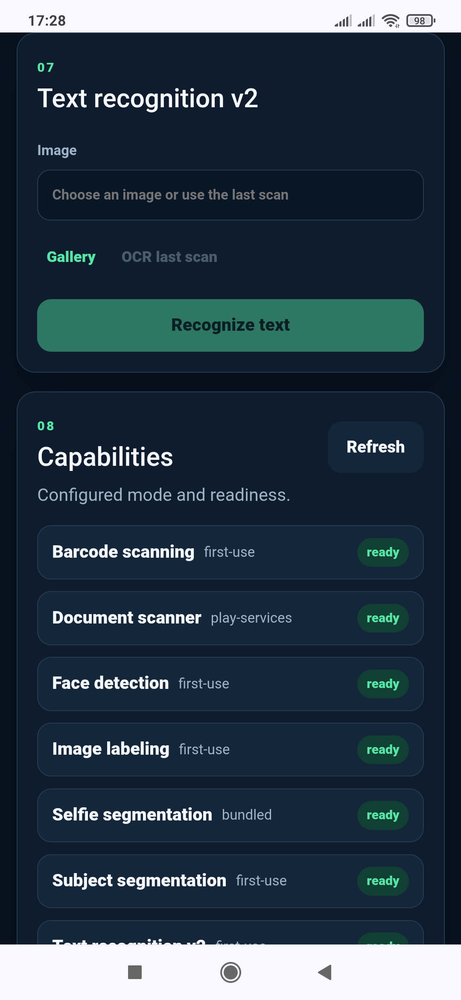</td>
    <td>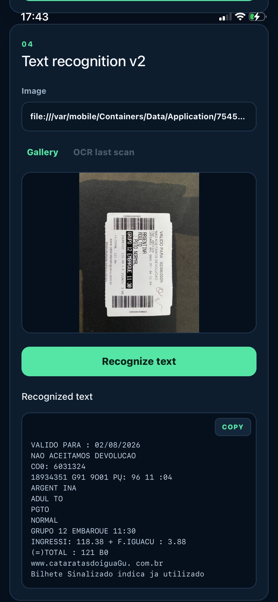</td>
  </tr>
</table>

```javascript
const text = await MlKit.recognizeText(result.pages[0].imagePath, {
    moduleLoadingMessage: "Loading text recognition…"
});
console.log(text);
```

`imagePath` can be an absolute native file path, a `file:` URI, an Android `content:` URI, or an `imageUri` previously returned by this plugin. Remote HTTP images are not fetched.

## Cancellation and errors

User cancellation of an interactive native UI resolves rather than rejects:

```javascript
{ "status": "cancelled", "reason": "user" }
```

Other failures reject with a stable shape:

```json
{
  "code": "UNSUPPORTED_DEVICE",
  "message": "ML Kit Document Scanner requires Android 7.0 or newer and at least 1.7 GB of total RAM.",
  "recoverable": false
}
```

| Code | Meaning |
| --- | --- |
| `INVALID_ARGUMENT` | An argument, option, or check is invalid. |
| `INVALID_IMAGE` | The supplied local image cannot be opened or decoded. |
| `BUSY` | Another interactive native session is active. |
| `CAMERA_PERMISSION_DENIED` | Camera permission is unavailable. |
| `CAMERA_UNAVAILABLE` | The requested camera or pipeline could not be opened. |
| `CAPTURE_FAILED` | No acceptable final face photo was obtained. |
| `PROCESSING_FAILED` | ML Kit or output persistence could not complete. |
| `SCANNER_UNAVAILABLE` | The document scanner could not be downloaded, initialized, or opened. |
| `MODULE_DOWNLOAD_CANCELLED` | Google Play services cancelled a requested model or scanner-component installation. |
| `MODULE_DOWNLOAD_FAILED` | Google Play services could not check or install the requested modules. |
| `UNSUPPORTED_DEVICE` | The current Android version, memory, or Google implementation does not support the document scanner. |
| `UNSUPPORTED_PLATFORM` | The requested module is not implemented on the current platform. |
| `TIMEOUT` | The configured interactive-session timeout elapsed. |
| `UNKNOWN` | The JavaScript bridge received an unstructured or otherwise unknown native error. |

## Privacy and limitations

### Dependencies and licenses

The plugin uses Google ML Kit, [AndroidX CameraX](https://developer.android.com/media/camera/camerax), and Apple system frameworks including AVFoundation. Plugin source is licensed under the MIT License; platform dependencies retain their own licenses and terms.

### Privacy

The plugin requests camera permission and processes camera frames and selected local images. It does not include analytics, advertising, network upload code, face recognition, or persistent biometric storage. Document Scanner and Subject Segmentation are provided through Google Play services; Selfie Segmentation is statically bundled. The host application controls returned files and is responsible for privacy disclosures, consent, retention, transport security, and regulatory compliance.

The included Apple privacy manifest declares no tracking, collected data, or required-reason API use by the plugin itself. Host applications and transitive SDKs must provide their own accurate manifests.

### Known limitations

- The Google Document Scanner always allows basic page editing, including crop and rotation; its native UI cannot be configured as an immutable front/back capture flow.
- Image labeling currently uses ML Kit's general-purpose default model; custom models are not yet supported.
- Selfie Segmentation is a beta ML Kit API. Hair, motion blur, occlusion, and low foreground/background contrast can produce imperfect edges.
- Subject Segmentation is a beta, Android-only ML Kit API and requires its Google Play services module before first inference.
- Text recognition currently includes only the Latin script recognizer.
- Face detection is not face recognition, identity verification, liveness detection, or presentation-attack detection.
- Face quality thresholds are heuristics and require calibration across devices, skin tones, lighting, optics, and accessibility needs.
- The face oval is a visual guide; the returned JPEG is rectangular.
- Cache URLs are session-local and are not durable storage.
- Camera and document-scanner behavior must be validated on representative physical devices.

## Support

If `cordova-plugin-mlkit-suite` is useful to you, consider [starring the repository](https://github.com/andreszs/cordova-plugin-mlkit-suite). Stars help other Cordova developers discover the project.

Financial contributions help cover the tools and devices used to develop, maintain, and test this and other open-source projects:

- [Ko-fi](https://ko-fi.com/D1D716OLPM)
- [PayPal](https://www.paypal.com/ncp/payment/GEEM324PDD9NC)
- USDC on Arbitrum One: `0xe36a336fC6cc9Daae657b4A380dA492AB9601e73`

> [!CAUTION]
> Send USDC using the Arbitrum One network only. Transfers sent through another network may be permanently lost.

## Tests

Run the JavaScript, Java confirmation, iOS source-contract, and localization-resource tests:

```bash
npm test
```

Before release, validate installation and a debug build with each supported Cordova Android major. Build iOS with `cordova-ios` 8.x on macOS, then test the native flows on physical devices.
